# OpenSynapse how-to guide

OpenSynapse is a load-testing tool you run yourself. You describe what virtual users
(VUs) should do — log in, browse, check out — in a visual plan; OpenSynapse turns the
plan into a [k6](https://k6.io) script, runs it, shows the results live, and lets you
change the load while the test is running.

This guide walks through everything in the order you will need it. Every screenshot
was taken from a real session against the test APIs that ship with OpenSynapse, so you
can follow along exactly.

**Contents**

1. [Start OpenSynapse](#1-start-opensynapse)
2. [Find your way around](#2-find-your-way-around)
3. [Your first test in five minutes](#3-your-first-test-in-five-minutes)
4. [Build a plan](#4-build-a-plan)
5. [Environments and variables](#5-environments-and-variables)
6. [Run a test](#6-run-a-test)
7. [Change the load while it runs](#7-change-the-load-while-it-runs)
8. [Read the results](#8-read-the-results)
9. [Compare runs](#9-compare-runs)
10. [Try a single request in the Playground](#10-try-a-single-request-in-the-playground)
11. [Generate a plan with the Crawler](#11-generate-a-plan-with-the-crawler)
12. [Settings](#12-settings)
13. [Teams: sign-in, roles and API tokens](#13-teams-sign-in-roles-and-api-tokens)
14. [Large tests on Kubernetes (cluster mode)](#14-large-tests-on-kubernetes-cluster-mode)
15. [The bundled test APIs](#15-the-bundled-test-apis)
16. [Troubleshooting](#16-troubleshooting)
17. [Glossary](#17-glossary)

---

## 1. Start OpenSynapse

You need [Docker Desktop](https://www.docker.com/products/docker-desktop/) (or Docker
Engine with the Compose plugin).

```bash
git clone https://github.com/opensynapse/opensynapse.git
cd opensynapse
docker compose -f user-testing/docker-compose.yml up -d --build
```

The first build takes a few minutes. When it finishes, open **http://localhost:8080**.

This starts OpenSynapse together with four small **test APIs** (an echo service, a mock
e-commerce shop, a slow API and an error-prone API) so you have something safe to test
straight away. Six built-in plans already point at them. Section 15 lists what each test
API does.

To start OpenSynapse on its own, without the test APIs, use
`docker compose -f deploy/docker/docker-compose.yml up -d --build` instead.

To stop everything: `docker compose -f user-testing/docker-compose.yml down`. Your plans
and results are kept in a Docker volume; add `-v` to delete them too.

> **Only test systems you own or have permission to test.** A load test is real traffic.

## 2. Find your way around

The bar at the top has six areas:

| Area | What it is for |
| --- | --- |
| **Plans** | Your test plans: create, import, open in the builder, run. |
| **Runs** | Every test you have run, with filters; tick two or more to compare. |
| **Environments** | Named sets of variables (base URLs, tokens) that plans use. |
| **Playground** | Send one request at a time, Postman-style, and try a quick burst. |
| **Crawler** | Discover endpoints from a website or an OpenAPI document and draft a plan. |
| **Settings** | Appearance, AI, integrations, storage, users and more. |

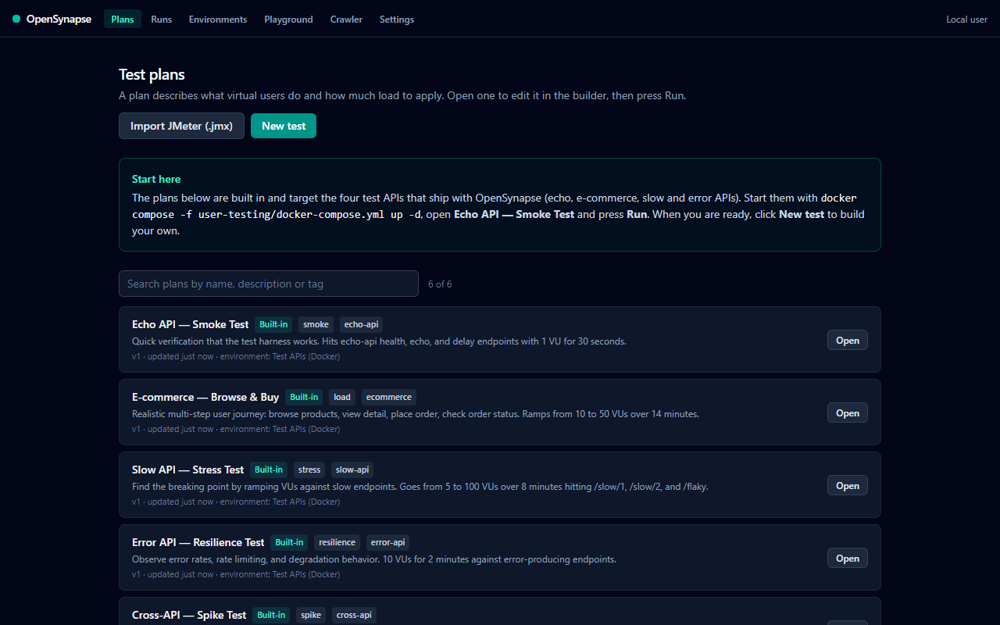

## 3. Your first test in five minutes

1. Go to **Plans** and click **E-commerce — Browse & Buy**. The plan builder opens.
2. Click **Run** (top right). The Run dialog shows the environment the plan uses
   (**Test APIs (Docker)**) and its load profile.
3. Click **Start run**. You land on the run's live dashboard.
4. Watch requests per second, response times and errors update every second.

   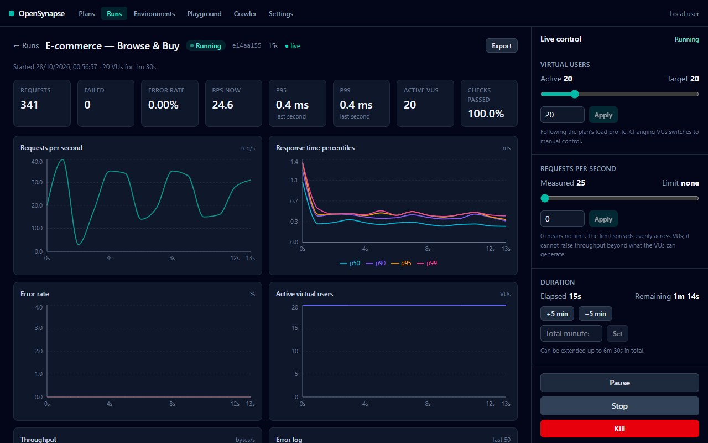

5. Click **Stop** when you have seen enough (or let it finish). The dashboard turns into
   a report.

That's the whole loop: *plan → run → watch → read the results*. The rest of this guide
goes into each step.

## 4. Build a plan

### Start a new plan

On **Plans**, click **New test** and pick a load profile. Each template comes with a
sample request to the echo test API, so you can run it immediately and then change it to
point at your own system. **Import JMeter (.jmx)** converts an existing JMeter plan and
lists anything it could not convert.

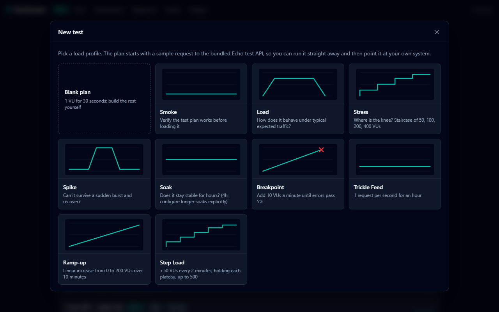

| Template | Shape | Use it to… |
| --- | --- | --- |
| Smoke | 1 VU, 30 s | check the plan works before adding load |
| Load | ramp up, hold, ramp down | see behaviour under expected traffic |
| Stress | staircase 50 → 400 VUs | find where it starts to struggle |
| Spike | sudden burst to 500 VUs | check recovery from a burst |
| Soak | 50 VUs for hours | find leaks and slow degradation |
| Breakpoint | +10 VUs a minute until errors pass 5% | find the breaking point (stops itself) |
| Trickle Feed | 1 request per second | long-running monitoring-style checks |
| Ramp-up | linear 0 → 200 VUs | find the knee in a smooth ramp |
| Step Load | +50 VUs every 2 minutes | measure each level separately |

### The builder

The builder has three panes:

- **Left — the tree.** The plan's structure. Click a node to select it, drag to move it
  (drop on the middle of a node to nest inside it), and search by name, type or value.
  **+ Add node** adds a node under the selection.
- **Middle — the canvas.** The same structure as a diagram. Use the buttons at the
  bottom left to zoom.
- **Right — properties.** Everything about the selected node.

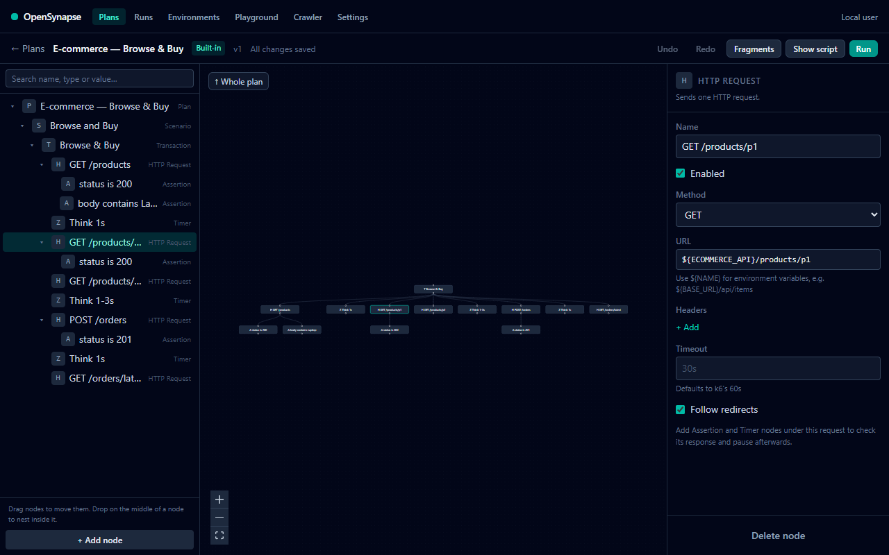

Changes save automatically ("All changes saved" in the header). **Undo**/**Redo** cover
every edit.

### Node types

| Node | What it does |
| --- | --- |
| **Plan** | The whole test: name, description, tags, default environment and **pass/fail thresholds**. |
| **Scenario** | How much load: the executor (constant VUs, ramping stages, arrival rate, iterations…). Its children are what each VU does. |
| **HTTP Request** | One request: method, URL, headers, body, timeout, redirects. |
| **WebSocket** | Connect, send messages, check replies. |
| **Code Block** | Your own k6 JavaScript for anything the builder can't express. It can set variables with `__vars.NAME = …`. |
| **If / Else** | Run children only when a condition is true (or false). |
| **Loop** | Repeat children a number of times or while a condition holds. |
| **Transaction** | Group requests under one name in the results. |
| **Once Only** | Run children once per VU (for example, log in). |
| **Random** | Run one child at random each iteration, optionally weighted. |
| **Assertion** | Check the parent request's response: status code, response time, body (contains, matches, JSONPath, exists) or a header. |
| **Timer** | Think time between steps: constant, uniform random or Gaussian. |
| **Data Source** | Load CSV or JSON test data shared across VUs. |

Put **Assertion** and **Timer** nodes *under* the request they belong to.

**Thresholds** (on the Plan node) are pass/fail rules in k6's syntax, for example
`http_req_duration` with `p(95)<500`, or `http_req_failed` with `rate<0.01`. A run whose
threshold fails is marked so in its report; tick **Abort** to end the run as soon as it
fails.

### See the script

**Show script** displays the k6 script the plan compiles to. It is a normal k6 script:
copy it and run `k6 run script.js` anywhere. Tick *Show the script OpenSynapse runs* to
see the version with the live-control additions.

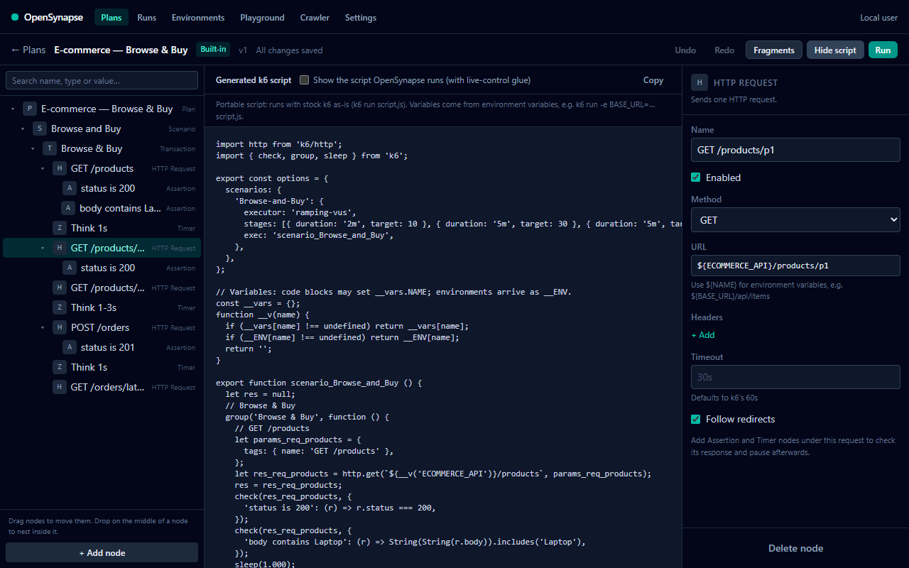

### Fragments

**Fragments** are reusable pieces of plan — a login flow, CSRF token extraction,
pagination, a checkout. Open the **Fragments** panel, pick one and click **Insert**; you
are asked for its variables (for example the base URL). To make your own, select a node
and click **Save "…" as fragment**; any `${VARIABLES}` inside become the fragment's
inputs.

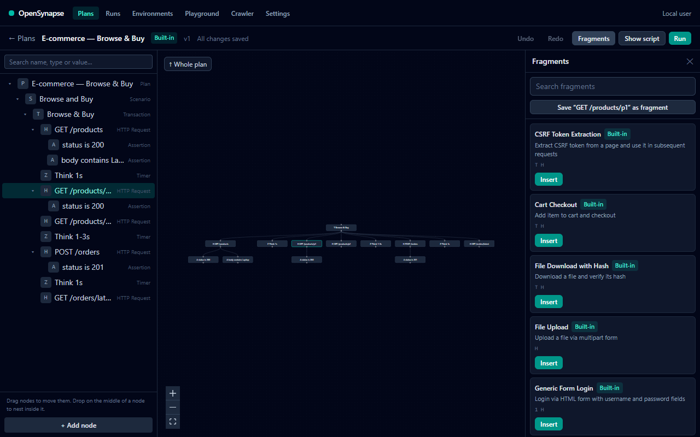

### Keyboard shortcuts in the builder

| Keys | Action |
| --- | --- |
| Ctrl/⌘ + S | Save now |
| Ctrl/⌘ + Z | Undo |
| Ctrl/⌘ + Y, or Ctrl/⌘ + Shift + Z | Redo |
| Ctrl/⌘ + C / X / V | Copy, cut, paste the selected node |
| Ctrl/⌘ + D | Duplicate the selected node |
| Delete | Delete the selected node |
| Esc | Close dialogs |

## 5. Environments and variables

Write `${NAME}` anywhere in a URL, header, body or auth field — for example
`${BASE_URL}/api/items`. An **environment** supplies the values, so the same plan can run
against staging today and production tomorrow.

On **Environments**, click **New environment** (or **Edit**) and add variables. Tick
**Secret** for passwords and tokens: they are encrypted at rest, never shown again, and
blanked out of exports and AI prompts.

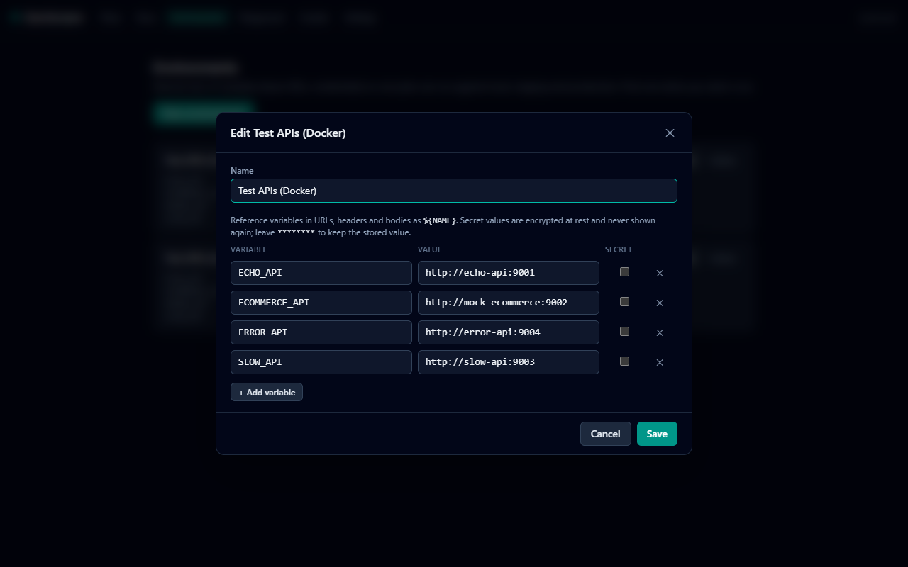

A plan has a **default environment** (on the Plan node); you can pick another in the Run
dialog. If the plan uses variables the chosen environment doesn't set, the Run dialog
warns you before you start — those requests would fail immediately.

## 6. Run a test

Click **Run** in the builder.

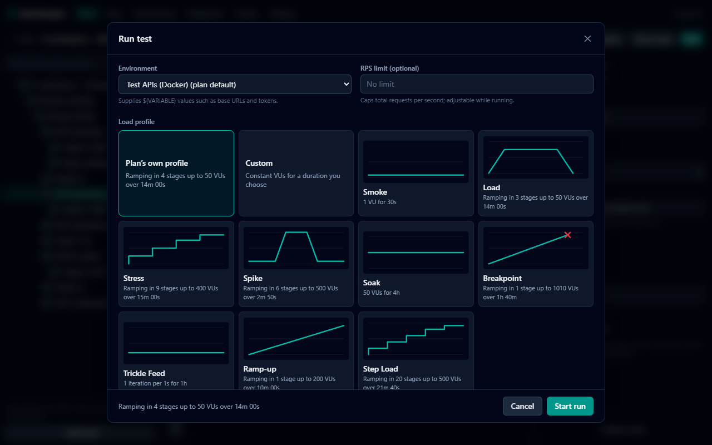

- **Environment** — where `${VARIABLES}` come from.
- **RPS limit** — an optional ceiling on requests per second across all VUs (you can
  change it during the run).
- **Load profile** — keep the plan's own profile, choose **Custom** (constant VUs for a
  duration), or try one of the templates without changing the plan. These overrides
  apply to this run only. Plans that use an arrival-rate or iteration executor always
  run with their own profile.
- **Workers** — only in cluster mode (section 14): how many k6 instances share the load.

Click **Start run**.

## 7. Change the load while it runs

The **Live control** panel on the right of a running test lets you change it without
restarting:


- **Virtual users** — type a number and **Apply**. This takes manual control; **Use plan
  profile** hands control back to the plan's stages.
- **Requests per second** — set a ceiling (0 removes it). The limit is spread evenly
  across VUs; it can lower throughput, never raise it beyond what the VUs can produce.
- **Duration** — **+5 min**, **−5 min**, or set a total. There is an upper bound shown
  under the buttons.
- **Pause / Resume** — VUs finish their current iteration and wait.
- **Stop** — ends gracefully and keeps every result.
- **Kill** — ends immediately; the run is marked *aborted*.

Each change is drawn as a dashed marker on every chart and listed in the **Timeline**,
so you can see its effect. You can also add your own notes to the timeline ("deploy
started") while the test runs.

Live changes work for VU-based scenarios (constant or ramping VUs). The RPS limit and
pause need the k6 build bundled in the Docker image.

## 8. Read the results

When a run ends, its page becomes a report:

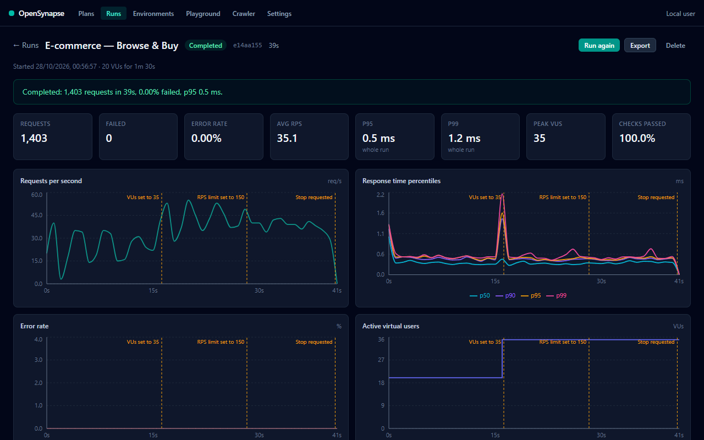

- The **banner** summarises the outcome (and any failed thresholds).
- The **cards** show totals: requests, failures, error rate, average RPS, p95 and p99
  response times, peak VUs, and the share of assertions that passed.
- The **charts** show requests per second, response-time percentiles, error rate, active
  VUs and throughput over time, with your live changes marked.
- Below them, **Endpoints** breaks everything down per request; **Assertions** shows each
  check's passes and failures; **Timeline** lists what happened when; **Error log** shows
  recent failed requests with status codes and messages.

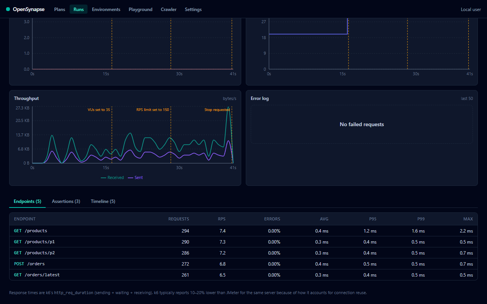

Response times are k6's `http_req_duration` (sending + waiting + receiving). k6 typically
reports 10–20% lower times than JMeter for the same server because of how it accounts for
connection reuse.

**Export** downloads the run as JSON (everything), CSV (raw samples, or per-second data),
HTML or PDF. **Run again** starts a new run with the same settings. **Delete** removes a
finished run.

## 9. Compare runs

On **Runs**, tick two or more runs (up to five) and click **Compare**. The first run is the
baseline.

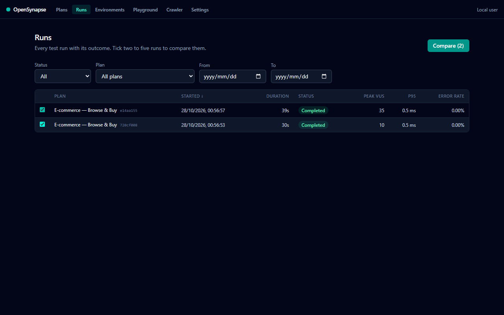

The comparison overlays the runs' charts and lists the differences that matter: a change
is only called out when it is statistically significant (Welch's t-test on the per-second
values, p < 0.05) and at least 2%. Tick *Align by % of run* to compare runs of different
lengths.

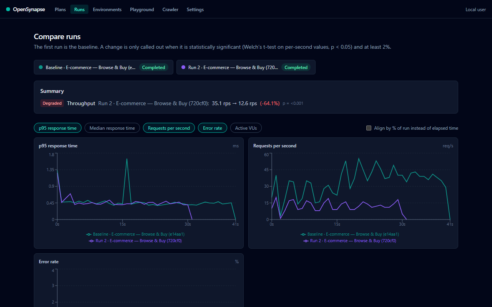

## 10. Try a single request in the Playground

The Playground sends one request at a time so you can get it right before adding it to a
plan.

1. Pick the method, type the URL (variables work: choose an environment on the right of
   the URL bar) and press **Send** or Ctrl+Enter.
2. Add **Params**, **Headers** and a **Body** (JSON, form or raw).
3. Read the response: status, time, size, **Body** (pretty or raw), **Headers**,
   **Cookies**, and a **Timing** breakdown (DNS, connect, TLS, waiting, receiving).

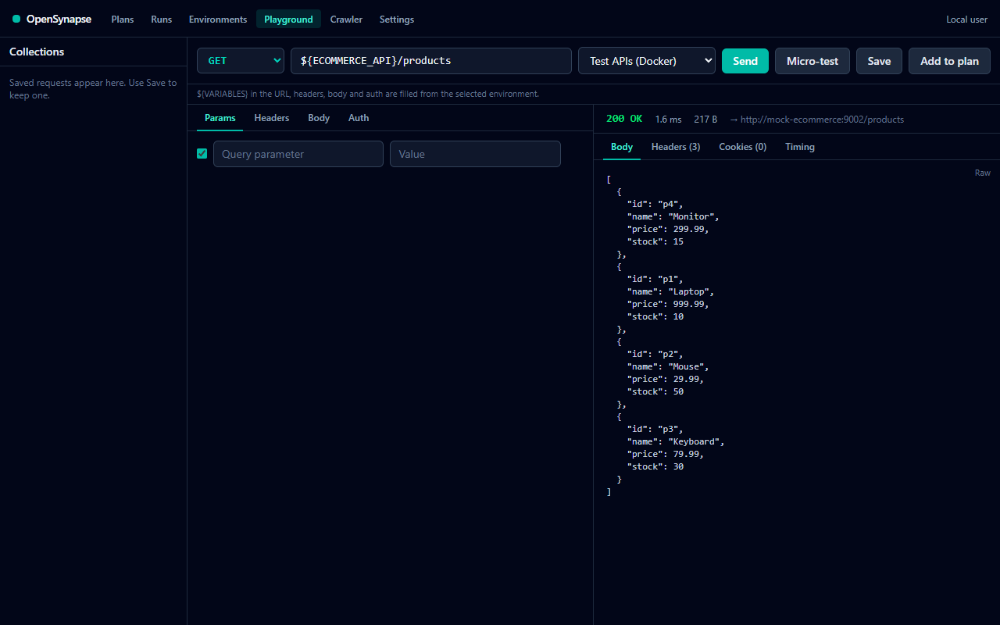

Requests are sent from the OpenSynapse server, not your browser — so `localhost` means the
server's machine, and inside Docker you use service names such as `mock-ecommerce`.

**Authentication** (the **Auth** tab) supports: none, Basic, Bearer token, API key (in a
header or the query string), Digest, OAuth 2.0 and *Inherit from environment*
(`AUTH_TOKEN`, `AUTH_USERNAME`/`AUTH_PASSWORD`, or `API_KEY` from the selected
environment). For OAuth 2.0, choose **Authorization code** (a sign-in window opens and the
token comes back automatically) or **Client credentials**, fill in the provider's URLs and
client details, and click **Get new access token**.

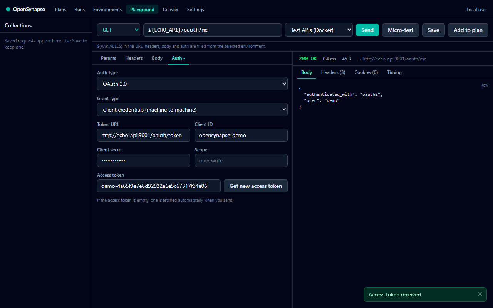

- **Save** keeps the request in a collection (left sidebar).
- **Add to plan** inserts it into a plan as an HTTP Request node, at the place you choose.
  Bearer, Basic and API-key auth become headers; OAuth becomes `Bearer ${AUTH_TOKEN}` so
  you can supply a fresh token from an environment.
- **Micro-test** runs a short k6 burst of this one request (1–50 VUs, 1–60 seconds) and
  shows the numbers and charts. It is not saved as a run.

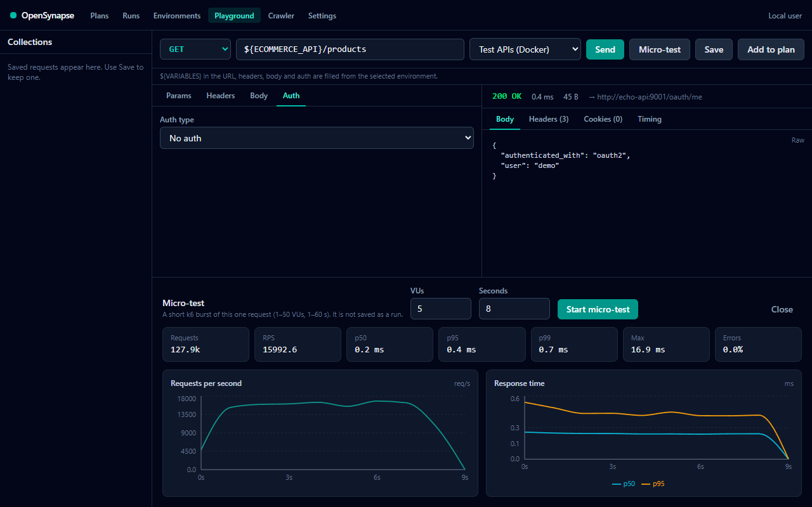

## 11. Generate a plan with the Crawler

The Crawler drafts a plan for you, two ways:

- **Import OpenAPI** — enter the URL of an OpenAPI 3 or Swagger 2 document (JSON or YAML).
  Every operation becomes a request, using the document's examples for path parameters
  and request bodies.
- **Crawl a website** — enter a start URL and choose an engine: **Colly** (fast, for
  server-rendered HTML), **Rod** (a real headless browser, for single-page apps) or
  **OWASP ZAP** (uses a ZAP daemon). Set the link depth, a request limit, URL parts to
  skip (logout and delete links are skipped by default) and, if needed, Basic, Bearer or
  form-login authentication.

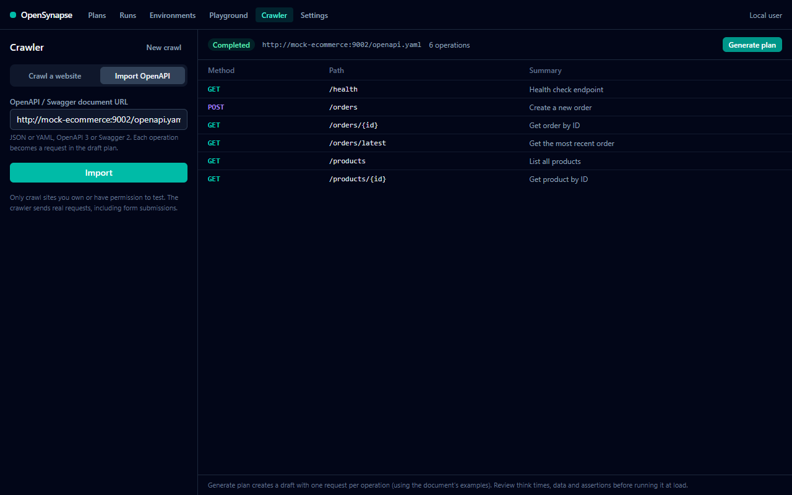

Click **Generate plan** to create the draft and open it in the builder. Review it before
running at load — add think times, test data and assertions.

To try it: import `http://mock-ecommerce:9002/openapi.yaml` (the test shop's own
description).

## 12. Settings

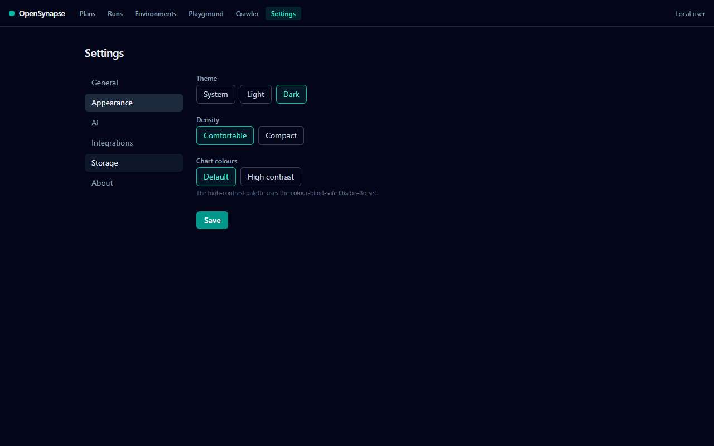

| Tab | What you can set |
| --- | --- |
| **General** | Default environment and template for new plans; the keyboard shortcut list. |
| **Appearance** | Dark, light or system theme; comfortable or compact density; chart palette (including a high-contrast, colour-blind-safe one). |
| **AI** | Optional AI analysis (below). |
| **Integrations** | A webhook (JSON) and/or a Slack incoming webhook, called when runs start and finish. |
| **Storage** | Where data lives, how much space it uses, and a retention policy (keep everything, the last N runs, or the last N days), applied hourly. |
| **Account** | Your password and personal API tokens (team mode). |
| **Users** | Add users and set roles (team mode, admins). |
| **About** | Version, k6 build, live-control capabilities, recent logs and a diagnostic bundle for bug reports (secrets removed). |

Click **Save** after changing a tab.

### AI analysis (optional)

AI is off until you turn it on. Choose a provider (OpenAI, Anthropic or Azure OpenAI),
paste **your own** API key, pick a model and optionally a monthly spending cap. Keys are
encrypted at rest.

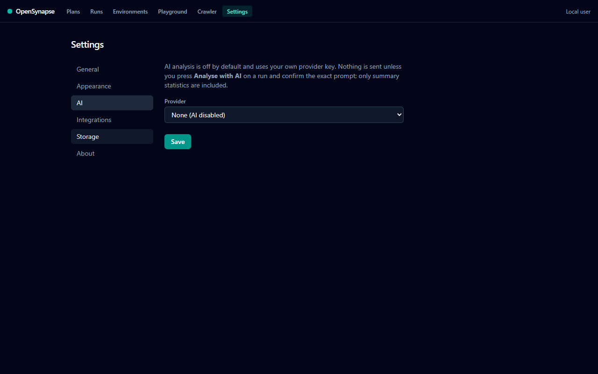

On a finished run (or a comparison), **Analyse with AI** lets you pick a question — *What
does this run tell me?*, *What changed between these runs?*, *What test should I run
next?* — or ask your own. **Preview prompt** shows exactly what would be sent (secrets
removed). Nothing leaves OpenSynapse until you click **Send to *provider***.

### Storage

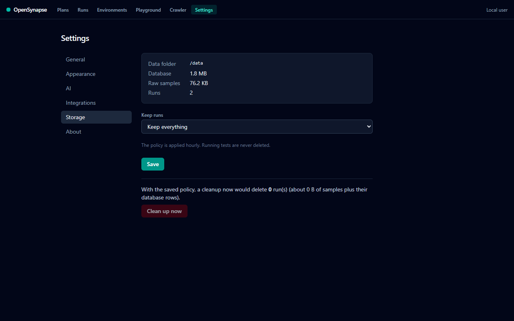

## 13. Teams: sign-in, roles and API tokens

A local install trusts whoever can reach it on your machine. To share OpenSynapse, turn on
**team mode** (`TEAM_MODE=true`, see the README). Everyone then signs in:

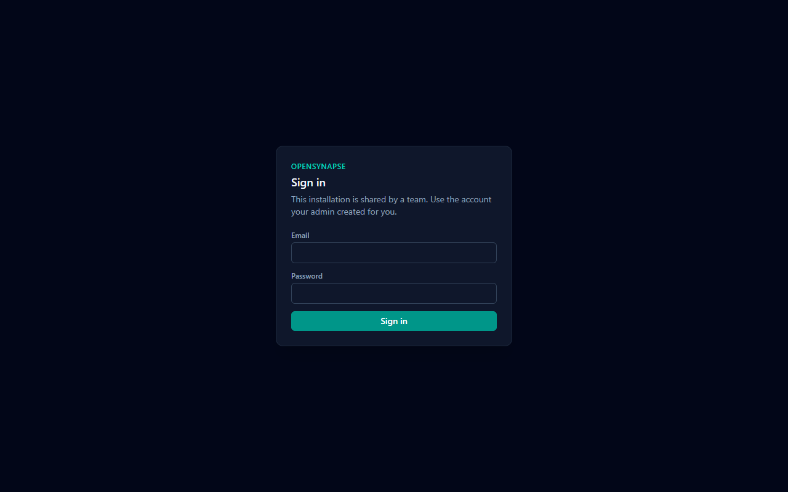

The first visitor creates the admin account (or the admin is created from
`OPENSYNAPSE_ADMIN_EMAIL`/`OPENSYNAPSE_ADMIN_PASSWORD`). Admins add people under
**Settings › Users**:

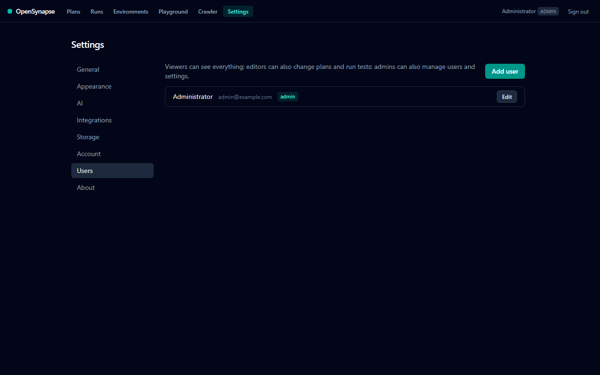

| Role | Can |
| --- | --- |
| **Viewer** | see plans, runs and results |
| **Editor** | also create and change plans and environments, and run tests |
| **Admin** | also manage users and settings |

For scripts and CI, create a **personal API token** under **Settings › Account** and send
it as `Authorization: Bearer <token>`. The full API is described at `/openapi.json` on your
server.

## 14. Large tests on Kubernetes (cluster mode)

One machine can only generate so much load. In cluster mode OpenSynapse runs on
Kubernetes and spreads each run over several k6 **workers** (pods), using the
[k6-operator](https://github.com/grafana/k6-operator). Install it with the Helm chart
(see the README). Everything works the same, with one addition — the **Workers** field in
the Run dialog:

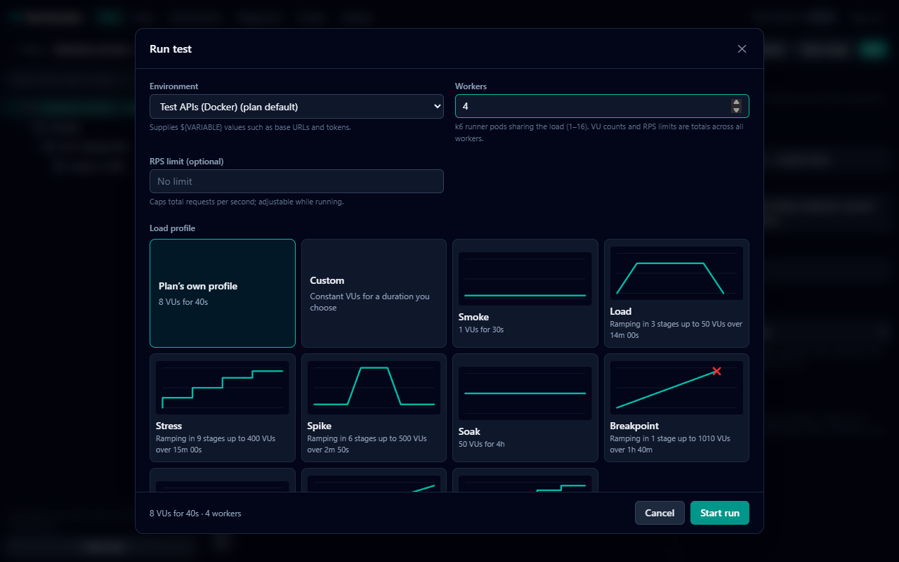

VU counts and RPS limits are totals across all workers: 40 VUs on 4 workers means 10 each.
While the workers are being scheduled, live control says so:

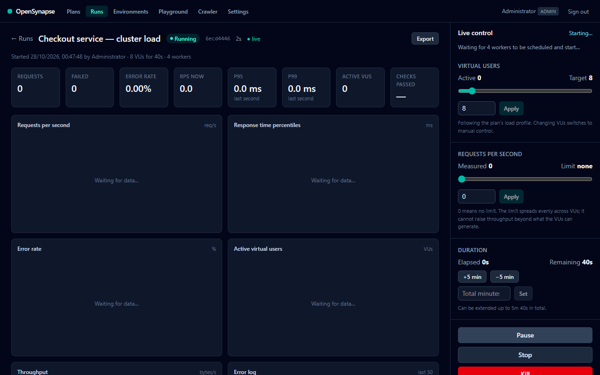

Once they start, the dashboard shows the combined results, and live changes reach every
worker within a couple of seconds:

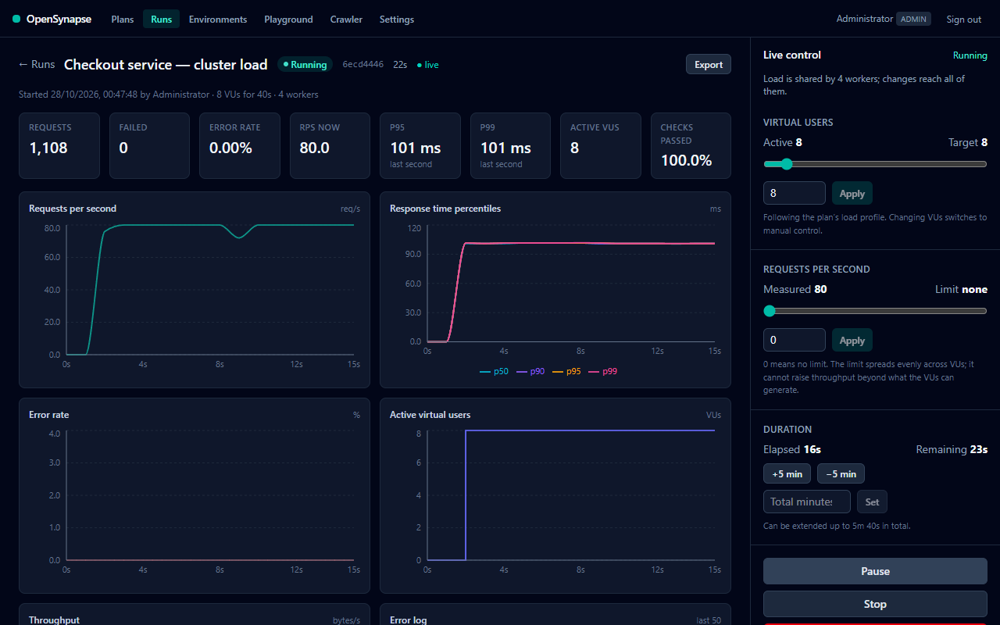

Each worker aggregates its results every second and sends them to OpenSynapse, so the
combined percentiles are exact and very high request rates are fine (30,000 requests per
second was tested). Cluster runs don't keep the raw-sample archive; CSV export gives the
per-second data instead.

## 15. The bundled test APIs

`user-testing/docker-compose.yml` starts these. Inside OpenSynapse use the service names
(the **Test APIs (Docker)** environment does); from your own machine use `localhost` and
the port.

| Service | Variable | Endpoints |
| --- | --- | --- |
| `echo-api:9001` | `ECHO_API` | `GET /health` · `POST /echo` (returns what you send) · `GET /delay/{ms}` · `GET /status/{code}` |
| `mock-ecommerce:9002` | `ECOMMERCE_API` | `GET /products` · `GET /products/{id}` (p1–p4) · `POST /orders` `{"product_ids":["p1"]}` · `GET /orders/latest` · `GET /orders/{id}` · `GET /openapi.yaml` |
| `slow-api:9003` | `SLOW_API` | `GET /slow/{seconds}` · `GET /timeout` · `GET /flaky` |
| `error-api:9004` | `ERROR_API` | `GET /random-error` · `GET /rate-limit` · `GET /degradation` |

The echo API also has endpoints for trying every Playground auth method:

| Endpoint | Credentials |
| --- | --- |
| `GET /auth/basic` | Basic: `demo` / `demo-pass` |
| `GET /auth/digest` | Digest: `demo` / `demo-pass` |
| `GET /auth/api-key` | API key `demo-key` in header `X-API-Key` or query `api_key` |
| `GET /oauth/me` | OAuth 2.0 — client `opensynapse-demo`, secret `demo-secret`; token URL `http://echo-api:9001/oauth/token`; authorization URL `http://localhost:9001/oauth/authorize` (your browser opens this one, so it uses `localhost`) |

The six built-in plans exercise these APIs: a smoke test, an e-commerce journey, a stress
test on the slow API, a resilience test on the error API, a spike across all four, and a
delay-validation test.

## 16. Troubleshooting

| You see | What it means / what to do |
| --- | --- |
| Every request fails instantly with `unsupported protocol scheme ""` | A `${VARIABLE}` in the URL has no value. Pick an environment that defines it (the Run dialog lists missing ones). |
| Requests to `localhost` fail | Requests are sent from the OpenSynapse server. In Docker, use service names (`mock-ecommerce`), or `host.docker.internal` for something on your own machine. |
| `Requests to host … are not allowed` | You opened OpenSynapse by an address it doesn't know. Add the hostname to `OPENSYNAPSE_ALLOWED_HOSTS`. |
| `Cross-origin requests from … are not allowed` | The web UI is served from a different origin than the API. Add that origin to `OPENSYNAPSE_ALLOWED_ORIGINS`. |
| "k6 engine is not available" | The server can't find k6. Use the Docker image (it bundles k6) or install k6 and set `OPENSYNAPSE_K6_PATH`. |
| RPS limit or Pause are greyed out | Your k6 lacks the xk6-kv extension. The Docker image includes it. |
| Live VU changes are not offered | The plan's scenario uses an arrival-rate or iteration executor, which k6 can't resize. Use constant or ramping VUs. |
| A run says "The control plane restarted while this run was in progress" | OpenSynapse was stopped mid-run; the run is marked failed with what it had. |
| Cluster run stuck on "Waiting for workers…" | The pods can't be scheduled or their image can't be pulled. After five minutes the run fails and its timeline shows why (for example `ImagePullBackOff`); `kubectl get pods` shows more sooner. |

Error codes returned by the API are listed in [docs/error-codes.md](../error-codes.md).

## 17. Glossary

| Term | Meaning |
| --- | --- |
| **VU (virtual user)** | One simulated user running the plan's steps in a loop. |
| **Iteration** | One pass of a VU through the scenario's children. |
| **RPS** | Requests per second. |
| **p95 / p99** | 95% (or 99%) of requests were faster than this. |
| **Executor** | How a scenario schedules VUs or iterations (constant VUs, ramping VUs, arrival rate…). |
| **Threshold** | A pass/fail rule on a metric, e.g. p95 under 500 ms. |
| **Assertion** | A check on one response; results appear under Assertions. |
| **Environment** | A named set of variables a plan uses. |
| **Fragment** | A reusable piece of plan. |
| **Worker** | One k6 instance (a pod) in cluster mode. |
